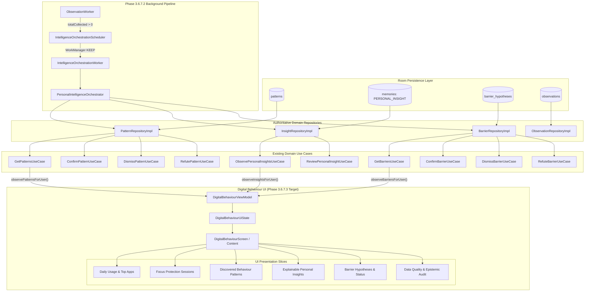

# IronMind-OS — Phase 3.6.7.3 Architecture Assessment
## Digital Behaviour Intelligence UI Integration

| Field | Details |
|---|---|
| **Phase** | Phase 3.6.7.3 — Architecture Assessment (Read-Only) |
| **Project Root** | `C:/Users/lenovo/OneDrive/Desktop/IronMind-OS` |
| **Android Module** | `C:/Users/lenovo/OneDrive/Desktop/IronMind-OS/IronMind` |
| **Branch** | `main` |
| **Baseline Commit** | `c4e5711a07465e047fa02abbefe01fa6a3350cd6` |
| **Status** | Assessment Complete — No Production/Source Files Modified |

---

## 1. Executive Summary & Core Objective

The objective of Phase 3.6.7.3 is to expose existing behavioural intelligence outputs directly within the Digital Behaviour screen, transforming it from a raw application-usage metrics dashboard into an explainable, evidence-backed Personal Intelligence interface.

Prior completed phases have already established:
- **Observation Pipeline (Phases 3.6.6.1 – 3.6.6.4R):** Crash-safe Room persistence, per-user monotonic checkpoints, lifecycle catchup on resume, and verified operational integrity.
- **Master Intelligence Orchestrator (Phases 3.3, 3.4, 3.6.7.1):** End-to-end local generation connecting `UnifiedContext → BehaviourPatternDiscoveryEngine → BarrierHypothesisDiscoveryEngine → PersonalInsightDiscoveryEngine`.
- **Background Scheduling (Phase 3.6.7.2):** Non-blocking background worker (`IntelligenceOrchestrationWorker`), coalescing via `ExistingWorkPolicy.KEEP`, 1-hour cooldown with exponential backoff, battery constraints, and SharedPreferences persistence.

This architecture assessment designs the **presentation and review layer** in the Digital Behaviour UI. **Strict architectural constraint:** Zero duplication of domain logic, repositories, entities, or schedulers. The UI will solely consume and interact with already committed Room repositories, existing use cases, and proven review workflows.



---

## 2. Existing Intelligence Data Sources: Code Inspection & Semantics

### 2.1 Behaviour Patterns

- **Engine:** [`BehaviourPatternDiscoveryEngine`](file:///C:/Users/lenovo/OneDrive/Desktop/IronMind-OS/IronMind/app/src/main/java/com/sanket_satpute_20/ironmind/domain/engine/BehaviourPatternDiscoveryEngine.kt)
  - Evaluates patterns across 4 categories: `PRODUCTIVITY`, `DIGITAL_BEHAVIOUR`, `FOCUS`, and `CROSS_DOMAIN`.
  - For `DIGITAL_BEHAVIOUR`:
    - Strict Permission Gating: If `digital.permissionStatus != GRANTED` or availability is `PERMISSION_DENIED`, pattern evaluation immediately aborts with zero false claims.
    - Pattern Types:
      - `FREQUENTLY_USED_APPLICATIONS`: Top apps with $\ge 15$ min duration or $\ge 3$ sessions.
      - `HIGH_USAGE_PERIODS`: Total phone usage $\ge 60$ minutes.
      - `REPEATED_APP_SESSIONS`: Rapid session switching ($\ge 5$ sessions).
  - Lifecycle Progression: `CANDIDATE` (N=1) $\rightarrow$ `EMERGING` (N=2 or 1 calendar day) $\rightarrow$ `ESTABLISHED` (N $\ge 3$ across $\ge 2$ distinct calendar days) $\rightarrow$ `WEAKENING` $\rightarrow$ `INACTIVE`.
- **Domain Model:** [`Pattern.kt`](file:///C:/Users/lenovo/OneDrive/Desktop/IronMind-OS/IronMind/app/src/main/java/com/sanket_satpute_20/ironmind/domain/model/pattern/Pattern.kt) / [`DiscoveredPattern.kt`](file:///C:/Users/lenovo/OneDrive/Desktop/IronMind-OS/IronMind/app/src/main/java/com/sanket_satpute_20/ironmind/domain/model/pattern/DiscoveredPattern.kt)
  - Fields: `id`, `userId`, `fingerprint`, `type: PatternType`, `description: String`, `conditions: String?`, `predictedBehavior: String?`, `confidence: Float` (0.0 to 1.0), `evidenceCount: Int`, `evidenceReferences: List<EvidenceReference>?`, `firstObservedAt: Long`, `lastObservedAt: Long`, `status: PatternStatus`, `confirmationState: MemoryConfirmationState`.
  - Extensions:
    - `val Pattern.lifecycleState: PatternLifecycleState`: decodes from JSON conditions.
    - `val Pattern.category: PatternCategory?`: decodes from JSON conditions.
- **Repository:** [`PatternRepository`](file:///C:/Users/lenovo/OneDrive/Desktop/IronMind-OS/IronMind/app/src/main/java/com/sanket_satpute_20/ironmind/domain/repository/PatternRepository.kt) & [`PatternRepositoryImpl`](file:///C:/Users/lenovo/OneDrive/Desktop/IronMind-OS/IronMind/app/src/main/java/com/sanket_satpute_20/ironmind/data/repository/PatternRepositoryImpl.kt)
  - Persisted in Room table `patterns` via `PatternEntity`.
  - Reactive query: `fun observePatternsForUser(userId: String): Flow<List<Pattern>>` backed by `PatternDao.observePatternsForUser(userId)` (`WHERE userId = :userId AND status != 'DELETED' ORDER BY lastObservedAt DESC`).
- **Review Actions:**
  - `ConfirmPatternUseCase(userId, patternId)`: Updates state to `MemoryConfirmationState.USER_CONFIRMED`, `status = ACTIVE`, and generates audit `Event(EventType.PATTERN_CONFIRMED)`.
  - `DismissPatternUseCase(userId, patternId)`: Updates state to `MemoryConfirmationState.USER_REJECTED`, `status = INACTIVE`, and generates audit `Event(EventType.PATTERN_DEACTIVATED)`.
  - `RefutePatternUseCase(userId, patternId)`: Updates state to `MemoryConfirmationState.USER_REJECTED`, `status = DELETED`, and generates audit `Event(EventType.PATTERN_REJECTED)`.

### 2.2 Personal Insights

- **Engine:** [`PersonalInsightDiscoveryEngine`](file:///C:/Users/lenovo/OneDrive/Desktop/IronMind-OS/IronMind/app/src/main/java/com/sanket_satpute_20/ironmind/domain/engine/PersonalInsightDiscoveryEngine.kt)
  - Generates explainable, evidence-backed insights across categories (`DIGITAL_BEHAVIOUR`, `FOCUS`, `CROSS_DOMAIN`, `PRODUCTIVITY`, `INTERVENTION_OUTCOME`).
  - Gated by Usage Access: Suppresses digital behaviour insights when permission is not granted.
  - Generates structured [`ExplainabilityBlock`](file:///C:/Users/lenovo/OneDrive/Desktop/IronMind-OS/IronMind/app/src/main/java/com/sanket_satpute_20/ironmind/domain/model/insight/PersonalInsight.kt#L40) answering:
    1. *What was observed?*
    2. *Over what period?*
    3. *What evidence supports this?*
    4. *Why does this matter?*
    5. *What is uncertain or unavailable?*
    6. *What can the user do next?*
- **Domain Model:** [`PersonalInsight.kt`](file:///C:/Users/lenovo/OneDrive/Desktop/IronMind-OS/IronMind/app/src/main/java/com/sanket_satpute_20/ironmind/domain/model/insight/PersonalInsight.kt)
  - Fields: `id`, `userId`, `category: InsightCategory`, `title: String`, `explanation: String`, `explainabilityBlock: ExplainabilityBlock`, `confidence: Float`, `epistemicAuthority: EpistemicAuthority`, `sourceProvenance: List<String>`, `sourceFreshness: SourceFreshness`, `reviewStatus: InsightReviewStatus`, `confirmationState: MemoryConfirmationState`, `userFeedback: String?`, `reviewedAt: Long?`, `createdAt: Long`, `updatedAt: Long`.
- **Repository:** [`InsightRepository`](file:///C:/Users/lenovo/OneDrive/Desktop/IronMind-OS/IronMind/app/src/main/java/com/sanket_satpute_20/ironmind/domain/repository/InsightRepository.kt) & [`InsightRepositoryImpl`](file:///C:/Users/lenovo/OneDrive/Desktop/IronMind-OS/IronMind/app/src/main/java/com/sanket_satpute_20/ironmind/data/repository/InsightRepositoryImpl.kt)
  - Persisted in Room table `memories` with `type = "PERSONAL_INSIGHT"` and JSON-serialized content via `InsightJsonCodec`.
  - Reactive query: `fun observeInsightsForUser(userId: String): Flow<List<PersonalInsight>>` backed by `dao.observeMemoriesForUser(userId)`.
- **Review Actions:**
  - `ReviewPersonalInsightUseCase.markUseful(insightId, userId)`: Updates `reviewStatus = USEFUL`.
  - `ReviewPersonalInsightUseCase.dismiss(insightId, userId)`: Updates `reviewStatus = DISMISSED` without deleting underlying evidence.
  - `ReviewPersonalInsightUseCase.reviewLater(insightId, userId)`: Updates `reviewStatus = REVIEW_LATER`.
  - `ReviewPersonalInsightUseCase.provideFeedback(insightId, userId, feedback)`: Stores user qualitative notes.

### 2.3 Barrier Hypotheses

- **Engine:** [`BarrierHypothesisDiscoveryEngine`](file:///C:/Users/lenovo/OneDrive/Desktop/IronMind-OS/IronMind/app/src/main/java/com/sanket_satpute_20/ironmind/domain/engine/BarrierHypothesisDiscoveryEngine.kt)
  - Discovers barriers such as `BarrierCategory.DISTRACTION` and `COGNITIVE_OVERLOAD`.
  - **Zero Inference on Denied Permission:** If `unifiedContext.digitalBehaviour.availability == PERMISSION_DENIED` or `permissionStatus != GRANTED`, distraction hypotheses are strictly suppressed and routed to `InsufficientEvidenceBarrier`.
  - Initial state: Always `epistemicAuthority = EpistemicAuthority.AI_HYPOTHESIS` and `confirmationState = BarrierConfirmationState.UNCONFIRMED`. **Never automatically confirmed.**
- **Domain Model:** [`BarrierHypothesis.kt`](file:///C:/Users/lenovo/OneDrive/Desktop/IronMind-OS/IronMind/app/src/main/java/com/sanket_satpute_20/ironmind/domain/model/barrier/BarrierHypothesis.kt)
  - Fields: `id`, `userId`, `category: BarrierCategory`, `title: String`, `description: String`, `confirmationState: BarrierConfirmationState`, `status: BarrierStatus`, `evidenceCount: Int`, `distinctDays: Int`, `confidence: Float`, `epistemicAuthority: EpistemicAuthority`, `sourceProvenance: List<String>`, `sourceFreshness: SourceFreshness`.
- **Repository:** [`BarrierRepository`](file:///C:/Users/lenovo/OneDrive/Desktop/IronMind-OS/IronMind/app/src/main/java/com/sanket_satpute_20/ironmind/domain/repository/BarrierRepository.kt) & [`BarrierRepositoryImpl`](file:///C:/Users/lenovo/OneDrive/Desktop/IronMind-OS/IronMind/app/src/main/java/com/sanket_satpute_20/ironmind/data/repository/BarrierRepositoryImpl.kt)
  - Persisted in Room table `barrier_hypotheses` via `BarrierHypothesisEntity`.
  - Reactive query: `fun observeBarriersForUser(userId: String): Flow<List<BarrierHypothesis>>` backed by `barrierDao.observeBarriersForUser(userId)`.
- **Review Actions:**
  - `ConfirmBarrierUseCase(userId, barrierId)`: Sets `confirmationState = CONFIRMED`, `status = ACTIVE`.
  - `DismissBarrierUseCase(userId, barrierId)`: Sets `confirmationState = DISMISSED`, `status = EXPIRED`.
  - `RefuteBarrierUseCase(userId, barrierId)`: Sets `confirmationState = REJECTED`, `status = EXPIRED`.

---

## 3. Exact Repository and Use-Case APIs

All components below exist in `IronMind/app/src/main/java` and are already registered in [`AppContainer`](file:///C:/Users/lenovo/OneDrive/Desktop/IronMind-OS/IronMind/app/src/main/java/com/sanket_satpute_20/ironmind/di/AppContainer.kt):

| Component | Method / Property | Return Type | Status & Location |
|---|---|---|---|
| `GetPatternsUseCase` | `observe(userId: String)` | `Flow<List<Pattern>>` | Committed ([GetPatternsUseCase.kt#L11](file:///C:/Users/lenovo/OneDrive/Desktop/IronMind-OS/IronMind/app/src/main/java/com/sanket_satpute_20/ironmind/domain/usecase/pattern/GetPatternsUseCase.kt#L11)) |
| `GetPatternsUseCase` | `invoke(userId: String)` | `suspend Result<List<Pattern>, Exception>` | Committed ([GetPatternsUseCase.kt#L15](file:///C:/Users/lenovo/OneDrive/Desktop/IronMind-OS/IronMind/app/src/main/java/com/sanket_satpute_20/ironmind/domain/usecase/pattern/GetPatternsUseCase.kt#L15)) |
| `ConfirmPatternUseCase` | `invoke(userId: String, patternId: String)` | `suspend Result<Unit, Exception>` | Committed ([ConfirmPatternUseCase.kt#L20](file:///C:/Users/lenovo/OneDrive/Desktop/IronMind-OS/IronMind/app/src/main/java/com/sanket_satpute_20/ironmind/domain/usecase/pattern/ConfirmPatternUseCase.kt#L20)) |
| `DismissPatternUseCase` | `invoke(userId: String, patternId: String)` | `suspend Result<Unit, Exception>` | Committed ([DismissPatternUseCase.kt#L20](file:///C:/Users/lenovo/OneDrive/Desktop/IronMind-OS/IronMind/app/src/main/java/com/sanket_satpute_20/ironmind/domain/usecase/pattern/DismissPatternUseCase.kt#L20)) |
| `RefutePatternUseCase` | `invoke(userId: String, patternId: String)` | `suspend Result<Unit, Exception>` | Committed ([RefutePatternUseCase.kt#L20](file:///C:/Users/lenovo/OneDrive/Desktop/IronMind-OS/IronMind/app/src/main/java/com/sanket_satpute_20/ironmind/domain/usecase/pattern/RefutePatternUseCase.kt#L20)) |
| `ObservePersonalInsightsUseCase` | `invoke(userId: String)` | `Flow<List<PersonalInsight>>` | Committed ([ObservePersonalInsightsUseCase.kt#L10](file:///C:/Users/lenovo/OneDrive/Desktop/IronMind-OS/IronMind/app/src/main/java/com/sanket_satpute_20/ironmind/domain/usecase/insight/ObservePersonalInsightsUseCase.kt#L10)) |
| `GetPersonalInsightsUseCase` | `invoke(userId: String)` | `suspend Result<List<PersonalInsight>, Exception>` | Committed ([GetPersonalInsightsUseCase.kt#L12](file:///C:/Users/lenovo/OneDrive/Desktop/IronMind-OS/IronMind/app/src/main/java/com/sanket_satpute_20/ironmind/domain/usecase/insight/GetPersonalInsightsUseCase.kt#L12)) |
| `ReviewPersonalInsightUseCase` | `markUseful(insightId, userId)` | `suspend Result<Unit, Exception>` | Committed ([ReviewPersonalInsightUseCase.kt#L27](file:///C:/Users/lenovo/OneDrive/Desktop/IronMind-OS/IronMind/app/src/main/java/com/sanket_satpute_20/ironmind/domain/usecase/insight/ReviewPersonalInsightUseCase.kt#L27)) |
| `ReviewPersonalInsightUseCase` | `dismiss(insightId, userId)` | `suspend Result<Unit, Exception>` | Committed ([ReviewPersonalInsightUseCase.kt#L36](file:///C:/Users/lenovo/OneDrive/Desktop/IronMind-OS/IronMind/app/src/main/java/com/sanket_satpute_20/ironmind/domain/usecase/insight/ReviewPersonalInsightUseCase.kt#L36)) |
| `ReviewPersonalInsightUseCase` | `reviewLater(insightId, userId)` | `suspend Result<Unit, Exception>` | Committed ([ReviewPersonalInsightUseCase.kt#L44](file:///C:/Users/lenovo/OneDrive/Desktop/IronMind-OS/IronMind/app/src/main/java/com/sanket_satpute_20/ironmind/domain/usecase/insight/ReviewPersonalInsightUseCase.kt#L44)) |
| `ReviewPersonalInsightUseCase` | `provideFeedback(insightId, userId, feedback)` | `suspend Result<Unit, Exception>` | Committed ([ReviewPersonalInsightUseCase.kt#L53](file:///C:/Users/lenovo/OneDrive/Desktop/IronMind-OS/IronMind/app/src/main/java/com/sanket_satpute_20/ironmind/domain/usecase/insight/ReviewPersonalInsightUseCase.kt#L53)) |
| `GetBarriersUseCase` | `observe(userId: String)` | `Flow<List<BarrierHypothesis>>` | Committed ([GetBarriersUseCase.kt#L11](file:///C:/Users/lenovo/OneDrive/Desktop/IronMind-OS/IronMind/app/src/main/java/com/sanket_satpute_20/ironmind/domain/usecase/barrier/GetBarriersUseCase.kt#L11)) |
| `GetBarriersUseCase` | `invoke(userId: String)` | `suspend Result<List<BarrierHypothesis>, Exception>` | Committed ([GetBarriersUseCase.kt#L15](file:///C:/Users/lenovo/OneDrive/Desktop/IronMind-OS/IronMind/app/src/main/java/com/sanket_satpute_20/ironmind/domain/usecase/barrier/GetBarriersUseCase.kt#L15)) |
| `ConfirmBarrierUseCase` | `invoke(userId: String, barrierId: String)` | `suspend Result<Unit, Exception>` | Committed ([ConfirmBarrierUseCase.kt#L20](file:///C:/Users/lenovo/OneDrive/Desktop/IronMind-OS/IronMind/app/src/main/java/com/sanket_satpute_20/ironmind/domain/usecase/barrier/ConfirmBarrierUseCase.kt#L20)) |
| `DismissBarrierUseCase` | `invoke(userId: String, barrierId: String)` | `suspend Result<Unit, Exception>` | Committed ([DismissBarrierUseCase.kt#L20](file:///C:/Users/lenovo/OneDrive/Desktop/IronMind-OS/IronMind/app/src/main/java/com/sanket_satpute_20/ironmind/domain/usecase/barrier/DismissBarrierUseCase.kt#L20)) |
| `RefuteBarrierUseCase` | `invoke(userId: String, barrierId: String)` | `suspend Result<Unit, Exception>` | Committed ([RefuteBarrierUseCase.kt#L20](file:///C:/Users/lenovo/OneDrive/Desktop/IronMind-OS/IronMind/app/src/main/java/com/sanket_satpute_20/ironmind/domain/usecase/barrier/RefuteBarrierUseCase.kt#L20)) |

---

## 4. Current UI and ViewModel Structure

### 4.1 Current Architecture & Screen Placement

`DigitalBehaviourScreen` is hosted primarily via [`ProtectionScreen.kt`](file:///C:/Users/lenovo/OneDrive/Desktop/IronMind-OS/IronMind/app/src/main/java/com/sanket_satpute_20/ironmind/ui/screens/protection/ProtectionScreen.kt) as **Tab 0 ("Digital Behaviour")**, reached directly from the Today Dashboard (`onNavigateToProtection` in [`TodayScreen.kt`](file:///C:/Users/lenovo/OneDrive/Desktop/IronMind-OS/IronMind/app/src/main/java/com/sanket_satpute_20/ironmind/ui/screens/today/TodayScreen.kt)). It can also be opened directly as [`DigitalBehaviourScreen`](file:///C:/Users/lenovo/OneDrive/Desktop/IronMind-OS/IronMind/app/src/main/java/com/sanket_satpute_20/ironmind/ui/screens/digital/DigitalBehaviourScreen.kt).

### 4.2 Current State Model
In [`DigitalBehaviourUiState.kt`](file:///C:/Users/lenovo/OneDrive/Desktop/IronMind-OS/IronMind/app/src/main/java/com/sanket_satpute_20/ironmind/ui/screens/digital/DigitalBehaviourUiState.kt):
```kotlin
data class DigitalBehaviourUiState(
    val selectedDate: LocalDate = LocalDate.now(),
    val isLoading: Boolean = false,
    val dailyUsage: DailyAppUsageIntelligence? = null,
    val isUsageAccessPermissionGranted: Boolean = false,
    val isUsageObservationEnabled: Boolean = true,
    val activeProtectionSessions: List<ProtectionSession> = emptyList(),
    val errorMessage: String? = null
)
```

### 4.3 Current ViewModel Mechanics
In [`DigitalBehaviourViewModel.kt`](file:///C:/Users/lenovo/OneDrive/Desktop/IronMind-OS/IronMind/app/src/main/java/com/sanket_satpute_20/ironmind/ui/screens/digital/DigitalBehaviourViewModel.kt):
1. **User & Session Awareness:** Collects `userSessionProvider.sessionState`. Upon `Authenticated` or `OfflineFallback`, invokes `loadData(...)` and `triggerCatchup(...)`.
2. **Lifecycle Catchup:** `triggerCatchup` executes `ExecuteObservationCollectionUseCase`. If `totalCollected > 0`, it triggers `intelligenceOrchestrationScheduler.scheduleOrchestration(...)`.
3. **Usage Intelligence Calculation:** Calls `GetDailyAppUsageIntelligenceUseCase` for the selected `LocalDate`.
4. **App Name Resolution:** Resolves package names to user-friendly application labels via `appNameResolver`.
5. **Protection Sessions:** Loads active focus protection sessions via `protectionRepository.getActiveProtectionSessionsForUser(...)`.

---

## 5. Recommended Screen Composition & Visual Hierarchy

The enhanced Digital Behaviour screen should retain its current calendar-based navigation at the top while appending structured intelligence sections beneath the raw usage metrics.

```
┌─────────────────────────────────────────────────────────────┐
│ TopAppBar: "Digital Behaviour & Intelligence" [Back] [Refresh]│
├─────────────────────────────────────────────────────────────┤
│ DateSelectorHeader: [< Yesterday | Today (2026-11-09) | >]  │
├─────────────────────────────────────────────────────────────┤
│ [Card] Permission Warning / Consent Banner (if ungranted)  │
├─────────────────────────────────────────────────────────────┤
│ SECTION 1: Daily Usage & Metrics                            │
│  - Total Screen Time (e.g. 2h 45m, +15% vs yesterday)      │
│  - Daily Unlock Count & App Session Totals                  │
│  - Most Used Applications (ranked list with app icons/names)│
├─────────────────────────────────────────────────────────────┤
│ SECTION 2: Active Focus Protection                          │
│  - Ongoing Protection Sessions / Scheduled Blocks           │
├─────────────────────────────────────────────────────────────┤
│ SECTION 3: Discovered Behaviour Patterns                    │
│  - Badge: EMERGING / ESTABLISHED / USER_CONFIRMED           │
│  - Title & Category ("Frequently Used App: YouTube")       │
│  - Description & Evidence Count ("45m across 4 sessions")   │
│  - Non-Causal Correlation Disclaimer (if Cross-Domain)      │
│  - Actions: [Confirm] [Dismiss] [Refute]                    │
├─────────────────────────────────────────────────────────────┤
│ SECTION 4: Explainable Personal Insights                    │
│  - Epistemic Authority Badge (SYSTEM_OBSERVED / AI_HYPO)    │
│  - Freshness Badge (CURRENT vs STALE)                       │
│  - Insight Title & Narrative Summary                        │
│  - Expandable Explainability Block (The 6 Questions)        │
│  - Actions: [Mark Useful] [Dismiss] [Review Later]          │
├─────────────────────────────────────────────────────────────┤
│ SECTION 5: Barrier Hypotheses                               │
│  - Warning Badge: "AI Hypothesis — Unconfirmed"             │
│  - Category ("Distraction: Late Night Digital Activity")    │
│  - Evidence Strength (N days, distinct observation count)   │
│  - Actions: [Confirm Barrier] [Dismiss] [Refute]            │
├─────────────────────────────────────────────────────────────┤
│ SECTION 6: Data Quality & Epistemic Audit                   │
│  - Freshness timestamp & observation checkpoint age         │
│  - Data completeness: FULL / PARTIAL / STALE / DENIED       │
│  - Direct link: "View Complete History & Audit Trail →"     │
└─────────────────────────────────────────────────────────────┘
```

---

## 6. Required UI State and Event Model Changes

### 6.1 Unified UI State Extension

Rather than creating separate fragment viewmodels, `DigitalBehaviourUiState` should be extended directly. This guarantees a single source of truth, eliminates race conditions, and aligns with the existing architecture.

```kotlin
data class DigitalBehaviourUiState(
    val selectedDate: LocalDate = LocalDate.now(),
    val isLoading: Boolean = false,
    val dailyUsage: DailyAppUsageIntelligence? = null,
    val isUsageAccessPermissionGranted: Boolean = false,
    val isUsageObservationEnabled: Boolean = true,
    val activeProtectionSessions: List<ProtectionSession> = emptyList(),
    val errorMessage: String? = null,
    
    // Phase 3.6.7.3: Intelligence Extensions
    val patterns: List<Pattern> = emptyList(),
    val insights: List<PersonalInsight> = emptyList(),
    val barriers: List<BarrierHypothesis> = emptyList(),
    val isSubmittingAction: Boolean = false,
    val actionError: String? = null
) {
    val effectiveAvailability: SourceAvailability
        get() = when {
            !isUsageAccessPermissionGranted -> SourceAvailability.PERMISSION_DENIED
            !isUsageObservationEnabled -> SourceAvailability.PERMISSION_NOT_REQUESTED
            dailyUsage != null -> dailyUsage.availability
            else -> SourceAvailability.EMPTY_NO_DATA
        }

    val digitalPatterns: List<Pattern>
        get() = patterns.filter {
            it.category == PatternCategory.DIGITAL_BEHAVIOUR ||
            it.category == PatternCategory.CROSS_DOMAIN ||
            it.category == PatternCategory.FOCUS
        }

    val digitalInsights: List<PersonalInsight>
        get() = insights.filter {
            it.category == InsightCategory.DIGITAL_BEHAVIOUR ||
            it.category == InsightCategory.FOCUS ||
            it.category == InsightCategory.CROSS_DOMAIN
        }

    val digitalBarriers: List<BarrierHypothesis>
        get() = barriers.filter {
            it.category == BarrierCategory.DISTRACTION ||
            it.category == BarrierCategory.COGNITIVE_OVERLOAD ||
            it.supportingPatternIds.any { pid -> digitalPatterns.any { dp -> dp.id == pid } }
        }
}
```

### 6.2 Reactive Flow Integration in `DigitalBehaviourViewModel`

```kotlin
class DigitalBehaviourViewModel(
    private val getDailyAppUsageIntelligenceUseCase: GetDailyAppUsageIntelligenceUseCase,
    private val appUsageObservationProvider: AppUsageObservationProvider,
    private val appUsageSettingsRepository: AppUsageObservationSettingsRepository,
    private val protectionRepository: ProtectionRepository,
    private val userSessionProvider: UserSessionProvider? = null,
    private val appNameResolver: ((String) -> String?)? = null,
    private val clock: Clock = object : Clock { override fun currentTimeMillis(): Long = System.currentTimeMillis() },
    private val zoneId: ZoneId = ZoneId.systemDefault(),
    private val executeObservationCollectionUseCase: ExecuteObservationCollectionUseCase? = null,
    private val ioDispatcher: CoroutineDispatcher = Dispatchers.IO,
    private val intelligenceOrchestrationScheduler: IntelligenceOrchestrationScheduler? = null,
    // Phase 3.6.7.3 Dependencies:
    private val getPatternsUseCase: GetPatternsUseCase? = null,
    private val confirmPatternUseCase: ConfirmPatternUseCase? = null,
    private val dismissPatternUseCase: DismissPatternUseCase? = null,
    private val refutePatternUseCase: RefutePatternUseCase? = null,
    private val observePersonalInsightsUseCase: ObservePersonalInsightsUseCase? = null,
    private val reviewPersonalInsightUseCase: ReviewPersonalInsightUseCase? = null,
    private val getBarriersUseCase: GetBarriersUseCase? = null,
    private val confirmBarrierUseCase: ConfirmBarrierUseCase? = null,
    private val dismissBarrierUseCase: DismissBarrierUseCase? = null,
    private val refuteBarrierUseCase: RefuteBarrierUseCase? = null
) : ViewModel() {
    // ...
}
```

### 6.3 Flow Observation Lifecycle
When `userSessionProvider.sessionState` enters `Authenticated(userId)`:
1. `combine` or separate collectors subscribe to:
   - `getPatternsUseCase.observe(userId)`
   - `observePersonalInsightsUseCase(userId)`
   - `getBarriersUseCase.observe(userId)`
2. Room emits updates immediately upon any change (such as when background orchestration finishes or when an action is executed).
3. The collectors cancel cleanly when session state resets to `Initializing`.

---

## 7. Review-Action Integration Strategy & Safety Invariants

The user can take review actions on patterns, insights, and barriers directly from the screen cards.

### 7.1 Epistemic & Action Rules

| Intelligence Entity | Action | Target State | Invariants Enforced |
|---|---|---|---|
| **Pattern** | `Confirm` | `USER_CONFIRMED` | Only `UNCONFIRMED` & `ACTIVE` patterns can be confirmed. Recorded as `Event(PATTERN_CONFIRMED)`. |
| **Pattern** | `Dismiss` | `USER_REJECTED` / `INACTIVE` | Soft deactivation. Underlying Room observations are preserved. Recorded as `Event(PATTERN_DEACTIVATED)`. |
| **Pattern** | `Refute` | `USER_REJECTED` / `DELETED` | Marked refuted. Suppressed from future pattern recommendations. Recorded as `Event(PATTERN_REJECTED)`. |
| **Insight** | `Mark Useful` | `reviewStatus = USEFUL` | **Epistemic Invariant:** Usefulness feedback is subjective feedback; it does **NOT** alter the objective epistemic authority (`SYSTEM_RECORDED_OBSERVATION` or `AI_HYPOTHESIS`). |
| **Insight** | `Dismiss` | `reviewStatus = DISMISSED` | Dismissing an insight never deletes underlying evidence. |
| **Insight** | `Review Later`| `reviewStatus = REVIEW_LATER` | Defers insight review without modifying evidence or status. |
| **Barrier** | `Confirm` | `CONFIRMED` | **Crucial Safety Rule:** Barriers are **NEVER** automatically confirmed by the system or AI. Only explicit user tap triggers `ConfirmBarrierUseCase`. Recorded as `Event(BARRIER_CONFIRMED)`. |
| **Barrier** | `Dismiss` | `DISMISSED` | Marks hypothesis expired without deleting evidence. |
| **Barrier** | `Refute` | `REJECTED` | Marks hypothesis rejected. Suppressed from future reasoning. |

### 7.2 Action Concurrency & Crash Safety
1. **Atomic Guard:** `private val isActionInProgress = AtomicBoolean(false)` prevents duplicate double-tap submissions.
2. **Session Security:** Every action executes inside `userSessionProvider.runWithSession { activeUserId -> ... }`, guaranteeing that a background user switch aborts the action before database mutation.
3. **Idempotency:** All underlying use cases (`ConfirmPatternUseCase`, `ConfirmBarrierUseCase`, etc.) verify idempotency before emitting events or writing to Room.

---

## 8. Data Quality, Epistemic Safeguards & Anti-Hallucination Guarantees

The Digital Behaviour screen must never mislead the user about missing, ungranted, or stale data:

1. **Anti-Hallucination Rule 1: No Zero-Usage Claims on Permission Denied**
   - If `isUsageAccessPermissionGranted == false` or `effectiveAvailability == PERMISSION_DENIED`:
     - Display: "Usage Access Permission Required".
     - **NEVER display:** "0m screen time", "0 unlocks", or "No distractions observed".
     - All digital patterns and distraction barriers must be hidden or marked "Unavailable due to missing permission".
2. **Anti-Hallucination Rule 2: Non-Causal Framing on Cross-Domain Data**
   - Cross-domain correlations (e.g. app usage co-occurring with task postponement) must display the explicit disclaimer:
     > *"Observed correlation does not imply causation. Device engagement during scheduled task time may reflect external factors rather than distraction."*
3. **Anti-Hallucination Rule 3: Stale Intelligence Warning**
   - If `sourceFreshness == SourceFreshness.STALE` or data age $> 24$ hours:
     - Prominently display a `STALE` badge with observation window timestamps.
     - Note in explainability: *"Data is older than 24 hours. Recent app interactions may not be reflected."*
4. **Anti-Hallucination Rule 4: Clear Distinction Between AI Hypothesis and Confirmed Fact**
   - An unconfirmed barrier hypothesis must be explicitly titled **"AI Hypothesis — Unconfirmed"**.
   - The UI must never suggest that IronMind has diagnosed the user with a productivity barrier until the user taps [Confirm].

---

## 9. Comprehensive Test Plan for Phase 3.6.7.3

Testing will focus on unit, integration, and UI regression across [`DigitalBehaviourViewModelTest.kt`](file:///C:/Users/lenovo/OneDrive/Desktop/IronMind-OS/IronMind/app/src/test/java/com/sanket_satpute_20/ironmind/ui/screens/digital/DigitalBehaviourViewModelTest.kt):

| Test Scenario | Test Description | Expected Result |
|---|---|---|
| **Pattern Reactive Loading** | Mock `getPatternsUseCase.observe(userId)` emitting patterns | `uiState.patterns` updates reactively; digital filter isolates `DIGITAL_BEHAVIOUR` and `CROSS_DOMAIN` |
| **Insight Reactive Loading** | Mock `observePersonalInsightsUseCase(userId)` emitting insights | `uiState.insights` updates reactively with full explainability blocks |
| **Barrier Reactive Loading** | Mock `getBarriersUseCase.observe(userId)` emitting barriers | `uiState.barriers` updates; unconfirmed distraction hypotheses labeled correctly |
| **Permission Denied Gating** | Set `appUsageProvider.permissionGranted = false` | Usage shows explicit `PERMISSION_DENIED`, digital intelligence cards show permission requirement banner, no false zero-usage claims |
| **Empty State Handling** | Database contains 0 patterns/insights/barriers | Screen displays graceful "No patterns discovered yet" state; no crashes |
| **Stale Data Warning** | Provide insight with `sourceFreshness = STALE` | Insight card renders stale warning indicator |
| **User/Session Isolation** | Switch `userSessionProvider` to new user | Previous user's patterns, insights, and barriers are immediately cleared and re-observed for new user |
| **Pattern Confirm Action** | Tap "Confirm" on pattern card | `confirmPatternUseCase` called with active userId and patternId; `isSubmittingAction` handled cleanly |
| **Insight Useful Action** | Tap "Mark Useful" on insight card | `reviewPersonalInsightUseCase.markUseful` called; epistemic authority remains intact |
| **Barrier Confirm Action** | Tap "Confirm" on barrier card | `confirmBarrierUseCase` invoked; barrier state updates to `CONFIRMED` |
| **Regression: Usage Metrics** | Verify existing daily usage, top apps, unlock counts | All existing metrics and tests in `DigitalBehaviourViewModelTest` pass with zero regressions |
| **Regression: Focus Sessions**| Verify active protection sessions display | Sessions remain displayed independently in Section 2 |

---

## 10. Implementation File Plan for Phase 3.6.7.3

### Files to be Modified:
1. [`DigitalBehaviourUiState.kt`](file:///C:/Users/lenovo/OneDrive/Desktop/IronMind-OS/IronMind/app/src/main/java/com/sanket_satpute_20/ironmind/ui/screens/digital/DigitalBehaviourUiState.kt)
   - Add `patterns`, `insights`, `barriers`, `isSubmittingAction`, and `actionError`.
   - Add convenience filter getters (`digitalPatterns`, `digitalInsights`, `digitalBarriers`).
2. [`DigitalBehaviourViewModel.kt`](file:///C:/Users/lenovo/OneDrive/Desktop/IronMind-OS/IronMind/app/src/main/java/com/sanket_satpute_20/ironmind/ui/screens/digital/DigitalBehaviourViewModel.kt)
   - Inject use cases (`GetPatternsUseCase`, `ConfirmPatternUseCase`, `DismissPatternUseCase`, `RefutePatternUseCase`, `ObservePersonalInsightsUseCase`, `ReviewPersonalInsightUseCase`, `GetBarriersUseCase`, `ConfirmBarrierUseCase`, `DismissBarrierUseCase`, `RefuteBarrierUseCase`).
   - Add observation collectors in `observeSession()`.
   - Add action dispatchers (`confirmPattern`, `dismissPattern`, `refutePattern`, `markInsightUseful`, `dismissInsight`, `reviewInsightLater`, `confirmBarrier`, `dismissBarrier`, `refuteBarrier`).
   - Update `ViewModelProvider.Factory` to wire use cases from `container`.
3. [`DigitalBehaviourScreen.kt`](file:///C:/Users/lenovo/OneDrive/Desktop/IronMind-OS/IronMind/app/src/main/java/com/sanket_satpute_20/ironmind/ui/screens/digital/DigitalBehaviourScreen.kt)
   - Add Composables:
     - `BehaviourPatternsSection(patterns, onConfirm, onDismiss, onRefute)`
     - `PersonalInsightsSection(insights, onMarkUseful, onDismiss, onReviewLater)`
     - `BarrierHypothesesSection(barriers, onConfirm, onDismiss, onRefute)`
     - `DataQualityAndAuditSection(freshness, onNavigateToHistory)`
   - Wire action lambdas into `DigitalBehaviourContent`.
4. [`DigitalBehaviourViewModelTest.kt`](file:///C:/Users/lenovo/OneDrive/Desktop/IronMind-OS/IronMind/app/src/test/java/com/sanket_satpute_20/ironmind/ui/screens/digital/DigitalBehaviourViewModelTest.kt)
   - Add test fixtures and verify all 12 test scenarios described in Section 9.

### Files Strictly Untouched:
- No changes to Room schema or migrations (`Migration29To30Test`, `AppDatabase`).
- No changes to domain engines (`BehaviourPatternDiscoveryEngine`, `BarrierHypothesisDiscoveryEngine`, `PersonalInsightDiscoveryEngine`, `PersonalIntelligenceOrchestrator`).
- No changes to background scheduling (`IntelligenceOrchestrationScheduler`, `IntelligenceOrchestrationWorker`, `ObservationWorker`).
- No changes to protection enforcement (`IronMindProtectionService`, `AccessibilityEnforcementService`).

---

## 11. Risks and Mitigation

| Risk | Impact | Mitigation Strategy |
|---|---|---|
| **LazyColumn Jitter / Composition Churn** | Repeated flow emissions cause list re-scrolling or stutter | Use stable keys for items (`key = { it.id }`), wrap cards in remember blocks, and coalesce flow updates. |
| **Session Switching Race Condition** | Fast logout/login mixes user intelligence | Gated by `isCurrentLoad(userId, generation)` and `userSessionProvider.runWithSession`. State resets to `isLoading = true` on `SessionState.Initializing`. |
| **Premature Barrier Confirmation** | User misunderstands AI hypothesis as factual | Explicit visual styling: Warning container color, "AI Hypothesis" badge, and requirement of explicit confirmation button click. |
| **Background Execution Overload** | UI refresh triggers redundant heavy ML calculation | UI **never** invokes `orchestrate()` directly. It observes Room and lets the Phase 3.6.7.2 background scheduler handle orchestration subject to 1-hour cooldown. |

---

## 12. Git Baseline and Safety Verification

```bash
$ git branch --show-current
main

$ git rev-parse HEAD
c4e5711a07465e047fa02abbefe01fa6a3350cd6

$ git status --short
# Preserved all pre-existing tracked modified files (188) and untracked files (222)
# Zero files staged, committed, reset, or removed
```

---

## 13. Recommended Implementation Sequence for Phase 3.6.7.3

1. **Step 1:** Extend `DigitalBehaviourUiState` with `patterns`, `insights`, `barriers`, `isSubmittingAction`, and `actionError`.
2. **Step 2:** Update `DigitalBehaviourViewModel` to accept the 10 domain use cases, observe pattern/insight/barrier flows reactively, and handle user review actions inside `runWithSession`.
3. **Step 3:** Update `DigitalBehaviourViewModel.Factory` to wire the dependencies from `AppContainer`.
4. **Step 4:** Build the UI composables in `DigitalBehaviourScreen.kt` for Patterns, Insights, Barriers, and Data Quality/Epistemic audit.
5. **Step 5:** Expand `DigitalBehaviourViewModelTest.kt` with comprehensive unit and integration tests verifying all loading, review, permission-denied, stale, and session-switch states.
6. **Step 6:** Run test suite and capture verification evidence.

