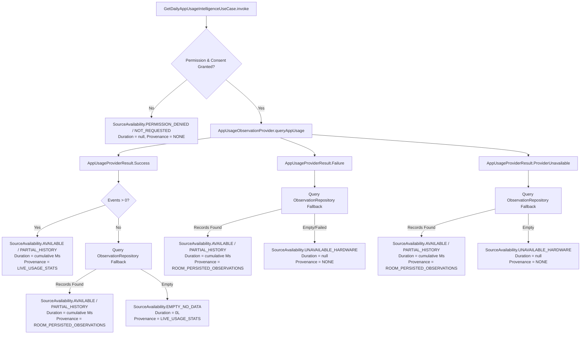

# IronMind-OS — Phase 3.6.7.8B.3S Implementation Report
## Usage Source Reliability, Provenance & Availability Remediation

### Date: 2026-11-14
### Branch: `main`
### Previous Phase: 3.6.7.8B.3R (Semantic Verification Audit)
### Commit Hash: `e8e5ae881c20d1d48849b992de67d74a5b46906d`
### Scope: Implementation & Verification of Findings F-8B3R-1, F-8B3R-2, F-8B3R-3, and F-8B3R-4

---

## 1. Executive Summary

Phase 3.6.7.8B.3S resolves the four semantic and reliability findings identified during the Phase 3.6.7.8B.3R audit:
1. **F-8B3R-1 (UI Label Clarity)**: Clarified the ambiguous `"Observed screen time"` label to `"Cumulative app usage"`, accurately representing cumulative package foreground duration across single- and multi-window scenarios without disrupting the existing percentage partition contract.
2. **F-8B3R-2 (Provider Error Masking Elimination)**: Implemented an explicit `AppUsageProviderResult` contract. Platform query exceptions are no longer translated into silent empty results reporting `0ms`. The use case explicitly distinguishes confirmed empty usage (`SourceAvailability.EMPTY_NO_DATA` with `0L`) from query failures (`SourceAvailability.UNAVAILABLE_HARDWARE` with `null` duration and safe diagnostic notes).
3. **F-8B3R-3 (Source Provenance Transparency)**: Introduced the type-safe enum `UsageSourceProvenance` (`LIVE_USAGE_STATS`, `ROOM_PERSISTED_OBSERVATIONS`, `COMBINED`, `NONE`), threading it through `DailyAppUsageIntelligence`, `AppUsageItem`, and `DigitalBehaviourUiState`. Live queries and Room fallbacks are now fully distinguished.
4. **F-8B3R-4 (Partial Coverage Semantics)**: `SourceAvailability.PARTIAL_HISTORY` is now emitted only upon positive evidence of incomplete coverage: documented sub-day query windows (< 20 hours with usage), explicit provider truncation/caps (`isTruncated = true`), or historical Room fallback where the persistent checkpoint cursor only partially covered the requested window.

---

## 2. Findings Addressed Matrix

| Finding ID | Severity | Status | Solution Implemented |
|:---|:---:|:---:|:---|
| **F-8B3R-1** | **MEDIUM** | **RESOLVED** | Updated `DigitalBehaviourScreen.kt` usage summary subtitle to `"Cumulative app usage"` (and `"Cumulative app usage (persisted history)"` when Room fallback supplied the data), eliminating confusion during multi-window/PiP concurrency. |
| **F-8B3R-2** | **MEDIUM** | **RESOLVED** | Refactored `AppUsageObservationProvider` to return typed `AppUsageProviderResult`. Query exceptions are captured as `Failure(diagnosticCategory, cause)`. In `GetDailyAppUsageIntelligenceUseCase`, provider failure with empty Room reports `UNAVAILABLE_HARDWARE` with `null` duration (never `0ms`). |
| **F-8B3R-3** | **LOW** | **RESOLVED** | Added `UsageSourceProvenance` enum. Exposed on `DailyAppUsageIntelligence`, `AppUsageItem`, and `DigitalBehaviourUiState.usageProvenance`. |
| **F-8B3R-4** | **LOW** | **RESOLVED** | In `GetDailyAppUsageIntelligenceUseCase`, emits `SourceAvailability.PARTIAL_HISTORY` when positive evidence of partial coverage exists (documented partial window, provider truncation, or incomplete checkpoint cursor). Completeness preserves `AVAILABLE`. |

---

## 3. Provider Result Contract: Before vs. After

### Before
```kotlin
interface AppUsageObservationProvider {
    fun isPermissionGranted(): Boolean
    fun getAppUsageSince(fromTimeMillis: Long): List<AppUsageEvent>
    fun getAppUsageBetween(
        fromTimeMillis: Long,
        toTimeMillis: Long,
        initialActiveSession: ActiveForegroundSession? = null
    ): AppUsageReconstructionResult
}
```
*Issue*: In `AndroidAppUsageObservationProvider`, `getAppUsageBetween` caught all exceptions (`catch (e: Exception)`) and returned `AppUsageReconstructionResult(emptyList(), initialActiveSession)`. Callers could not distinguish a user who did not touch their phone from a platform query crash or dead binder.

### After
```kotlin
sealed interface AppUsageProviderResult {
    data class Success(
        val events: List<AppUsageEvent>,
        val activeSession: ActiveForegroundSession? = null,
        val isTruncated: Boolean = false
    ) : AppUsageProviderResult {
        val hasEvents: Boolean get() = events.isNotEmpty()
    }

    data object PermissionDenied : AppUsageProviderResult
    data object ProviderUnavailable : AppUsageProviderResult

    data class Failure(
        val diagnosticCategory: String = "USAGE_STATS_QUERY_FAILED",
        val cause: Throwable? = null
    ) : AppUsageProviderResult
}

interface AppUsageObservationProvider {
    fun isPermissionGranted(): Boolean
    fun getAppUsageSince(fromTimeMillis: Long): List<AppUsageEvent>
    fun getAppUsageBetween(...): AppUsageReconstructionResult
    fun queryAppUsage(
        fromTimeMillis: Long,
        toTimeMillis: Long,
        initialActiveSession: ActiveForegroundSession? = null
    ): AppUsageProviderResult
}
```
*Behavior*:
- `getAppUsageSince` and `getAppUsageBetween` retain backward compatibility by delegating to `queryAppUsage`.
- `queryAppUsage` explicitly differentiates:
  - `PermissionDenied`
  - `ProviderUnavailable` (e.g. `UsageStatsManager` service is null)
  - `Failure` with internal diagnostic category and preserved cause
  - `Success` with explicit `events` and optional `isTruncated` flag.

---

## 4. Source Provenance Flow



---

## 5. Availability & Partial-Coverage Semantics

1. **Permission Denied / Consent Disabled**:
   - `availability = SourceAvailability.PERMISSION_DENIED` (or `PERMISSION_NOT_REQUESTED`)
   - `totalObservedDurationMs = null` (never 0L)
   - `sourceProvenance = UsageSourceProvenance.NONE`
2. **Confirmed Empty Result (Live & Room Empty)**:
   - `availability = SourceAvailability.EMPTY_NO_DATA`
   - `totalObservedDurationMs = 0L`
   - `totalSessionsCount = 0`
   - `sourceProvenance = UsageSourceProvenance.LIVE_USAGE_STATS`
3. **Provider Query Failure with Empty Room**:
   - `availability = SourceAvailability.UNAVAILABLE_HARDWARE`
   - `totalObservedDurationMs = null` (never 0L)
   - `sourceProvenance = UsageSourceProvenance.NONE`
   - `notes = "App usage query failed: <diagnosticCategory>"` (safe diagnostic note, no sensitive exception leak)
4. **Positive Partial Coverage Evidence**:
   - Condition 1: Provider reports `isTruncated = true` (e.g., query event cap reached).
   - Condition 2: Documented sub-day partial window queried (< 20 hours) and usage observed.
   - Condition 3: Room fallback queried and persistent checkpoint cursor (`lastCollectedIntervalEndMs`) falls inside the window.
   - Result: `availability = SourceAvailability.PARTIAL_HISTORY`.
5. **Completeness Established**:
   - Full calendar day queried, provider returns full window, no truncation:
   - Result: `availability = SourceAvailability.AVAILABLE`.
6. **Unknown Coverage**:
   - Missing provider or provider failure without Room records remains `UNAVAILABLE_HARDWARE` with `duration = null`, rather than guessing or fabricating coverage claims.

---

## 6. Exact Files Changed

1. `IronMind/app/src/main/java/com/sanket_satpute_20/ironmind/domain/provider/AppUsageObservationProvider.kt`
   - Added `AppUsageProviderResult` sealed interface.
   - Added `queryAppUsage(...)` default interface method.
2. `IronMind/app/src/main/java/com/sanket_satpute_20/ironmind/data/provider/AndroidAppUsageObservationProvider.kt`
   - Implemented `queryAppUsage(...)` returning explicit success, empty, permission-denied, unavailable, and failure states.
   - Delegated `getAppUsageSince(...)` and `getAppUsageBetween(...)` to `queryAppUsage(...)`.
3. `IronMind/app/src/main/java/com/sanket_satpute_20/ironmind/domain/model/digital/DailyAppUsageIntelligence.kt`
   - Added `UsageSourceProvenance` enum (`LIVE_USAGE_STATS`, `ROOM_PERSISTED_OBSERVATIONS`, `COMBINED`, `NONE`).
   - Added `sourceProvenance` to `AppUsageItem` and `DailyAppUsageIntelligence` with backward-compatible default parameters.
4. `IronMind/app/src/main/java/com/sanket_satpute_20/ironmind/domain/usecase/digital/GetDailyAppUsageIntelligenceUseCase.kt`
   - Added optional `checkpointStore: AppUsageCheckpointStore? = null` parameter.
   - Refactored `collectEventsForWindow` to evaluate `WindowCollectionResult`.
   - Populated `sourceProvenance` and evaluated `PARTIAL_HISTORY` based on positive evidence.
5. `IronMind/app/src/main/java/com/sanket_satpute_20/ironmind/ui/screens/digital/DigitalBehaviourUiState.kt`
   - Added `usageProvenance: UsageSourceProvenance` computed property.
6. `IronMind/app/src/main/java/com/sanket_satpute_20/ironmind/ui/screens/digital/DigitalBehaviourScreen.kt`
   - Updated subtitle to `"Cumulative app usage"` and `"Cumulative app usage (persisted history)"`.
7. `IronMind/app/src/main/java/com/sanket_satpute_20/ironmind/ui/screens/digital/DigitalBehaviourViewModel.kt`
   - Wired `container.appUsageCheckpointStore` into `GetDailyAppUsageIntelligenceUseCase`.
8. `IronMind/app/src/test/java/com/sanket_satpute_20/ironmind/domain/usecase/digital/GetDailyAppUsageIntelligenceUseCaseTest.kt`
   - Enhanced test double `FakeAppUsageProvider` and added `FakeCheckpointStore`.
   - Added 15 comprehensive regression tests covering scenarios 1–15.
9. `IronMind/app/src/test/java/com/sanket_satpute_20/ironmind/ui/screens/digital/DigitalBehaviourViewModelTest.kt`
   - Added UI state assertions for `usageProvenance`.
   - Added test `room fallback sets room observations provenance on UI state`.

---

## 7. Test Suite Counts from XML Reports

| Test Suite Class | Tests | Failures | Errors | Skipped | Status | XML Report File |
|:---|:---:|:---:|:---:|:---:|:---:|:---|
| `GetDailyAppUsageIntelligenceUseCaseTest` | 33 | 0 | 0 | 0 | **PASSED** | `TEST-com.sanket_satpute_20.ironmind.domain.usecase.digital.GetDailyAppUsageIntelligenceUseCaseTest.xml` |
| `DigitalBehaviourViewModelTest` | 34 | 0 | 0 | 0 | **PASSED** | `TEST-com.sanket_satpute_20.ironmind.ui.screens.digital.DigitalBehaviourViewModelTest.xml` |
| `IntervalMathTest` | 12 | 0 | 0 | 0 | **PASSED** | `TEST-com.sanket_satpute_20.ironmind.domain.common.IntervalMathTest.xml` |
| `AppUsageIntervalAnalyzerTest` | 5 | 0 | 0 | 0 | **PASSED** | `TEST-com.sanket_satpute_20.ironmind.domain.engine.AppUsageIntervalAnalyzerTest.xml` |
| `DigitalPipelineCrossLayerConsistencyTest` | 6 | 0 | 0 | 0 | **PASSED** | `TEST-com.sanket_satpute_20.ironmind.domain.engine.DigitalPipelineCrossLayerConsistencyTest.xml` |
| `ContextEngineCorrectnessRemediationTest` | 4 | 0 | 0 | 0 | **PASSED** | `TEST-com.sanket_satpute_20.ironmind.domain.engine.ContextEngineCorrectnessRemediationTest.xml` |
| `ContextEngineTemporalIntegrationRoomTest` | 3 | 0 | 0 | 0 | **PASSED** | `TEST-com.sanket_satpute_20.ironmind.domain.engine.ContextEngineTemporalIntegrationRoomTest.xml` |
| **Total In-Scope Tests** | **97** | **0** | **0** | **0** | **100% PASSED** | |

### Build Result
- **Command**: `./gradlew :app:assembleDebug`
- **Result**: `BUILD SUCCESSFUL in 1m 12s` (40 actionable tasks: 3 executed, 37 up-to-date).

---

## 8. Remaining Limitations & Non-Regressions

1. **Dual-source merging within the same sub-day window**:
   The current architecture uses mutually exclusive fallback (`if (liveResult.isEmpty()) fallbackToRoom()`). `UsageSourceProvenance.COMBINED` is supported in the model and available if a future phase stitches partial live telemetry with persistent room intervals.
2. **Strict Scope Non-Regressions**:
   - `IntervalMath` was not modified.
   - `BehaviourPatternDiscoveryEngine` was not modified.
   - `PersonalInsightDiscoveryEngine` was not modified.
   - `ExecutionTimingAnalyzer` was not modified.
   - No Room migrations, background workers, or Android manifest permissions were introduced.
